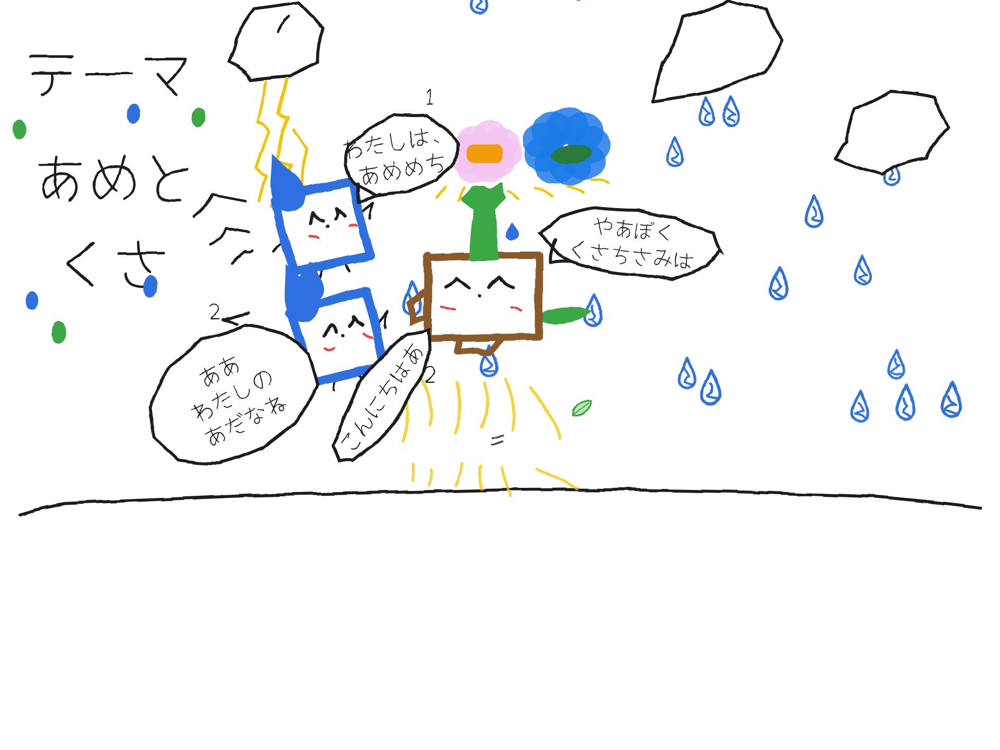

# Natsukiart

こどもの絵をアニメーションにする作品集。

## テーマ あめと くさ

子どもが描いた絵「テーマ あめと くさ」をもとにした、10秒ループの2Dアニメーションです。手描き線の揺れ（ラインボイル）付き。

- `index.html` … ブラウザで開くと再生（SVG + JavaScript、ライブラリ不要）。末尾に `#record` を付けると絵だけを全画面表示
- `ame-to-kusa.mp4` … 1920×1440 / 24fps / 10秒（ループ素材）
- `ame-to-kusa.gif` … 800×600 / 12fps

| 時間 | 演出 |
|---|---|
| 0.0–2.5s | 雨が降り、左上の雲から稲妻 |
| 2.5–5.5s | あめめち2体がぴょんぴょん跳ね、吹き出しが出る |
| 5.5–8.5s | くさちさみはが大ジャンプ、頭の草から花が咲き、吹き出しが出る |
| 8.5–10s | 全員でジャンプして0秒目へループ |

動画・画像生成AI用のプロンプトは `index.html` の下部に載せています。
